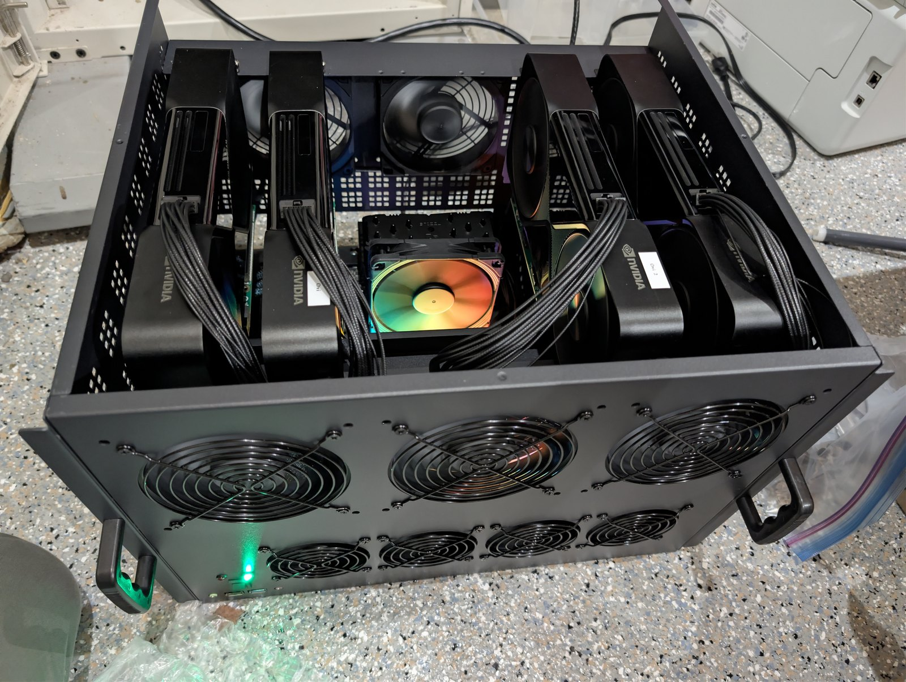
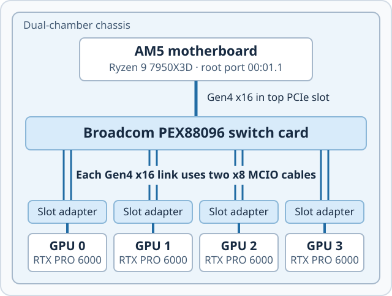
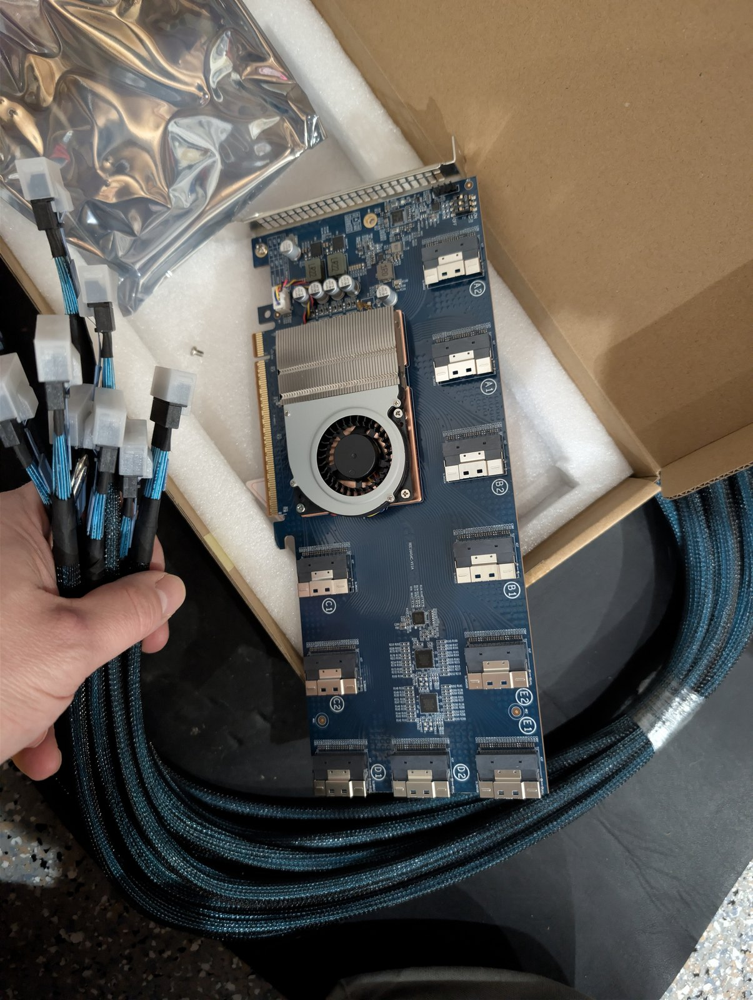
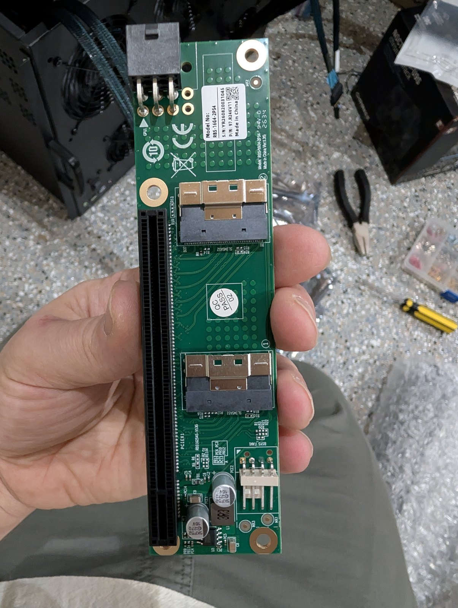
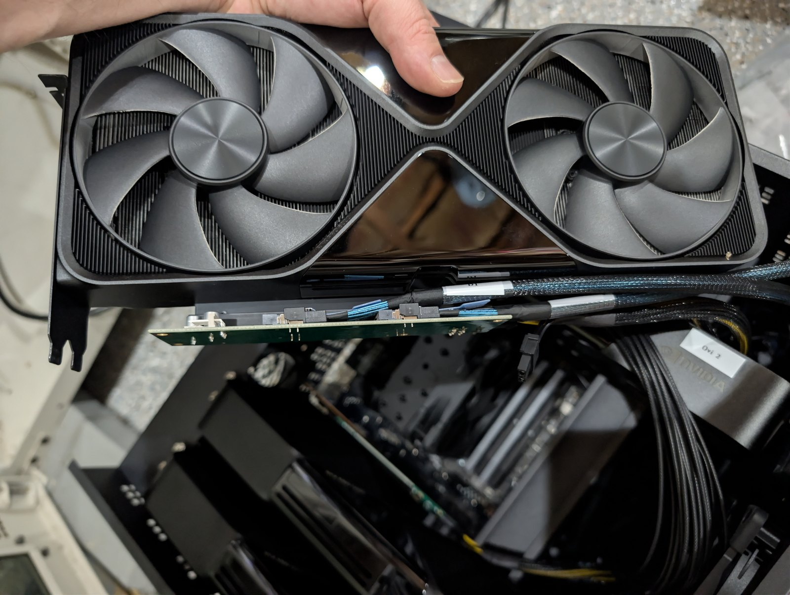
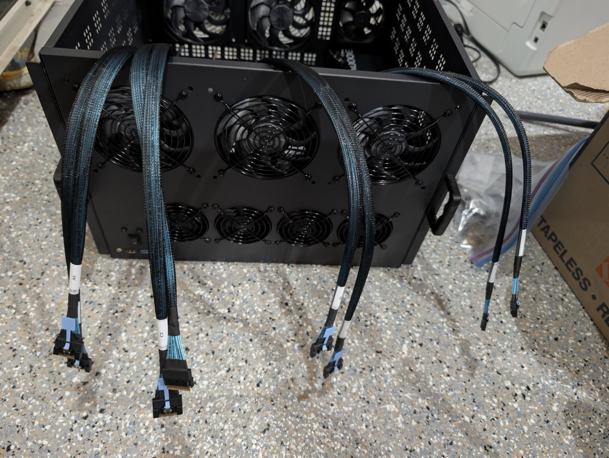
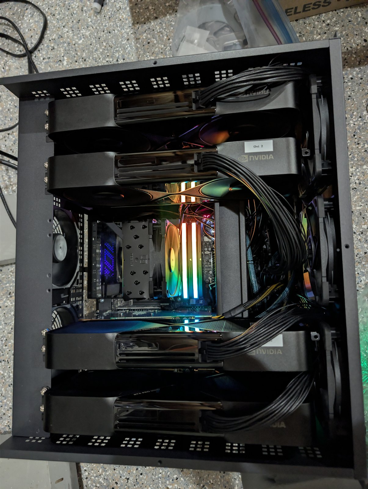
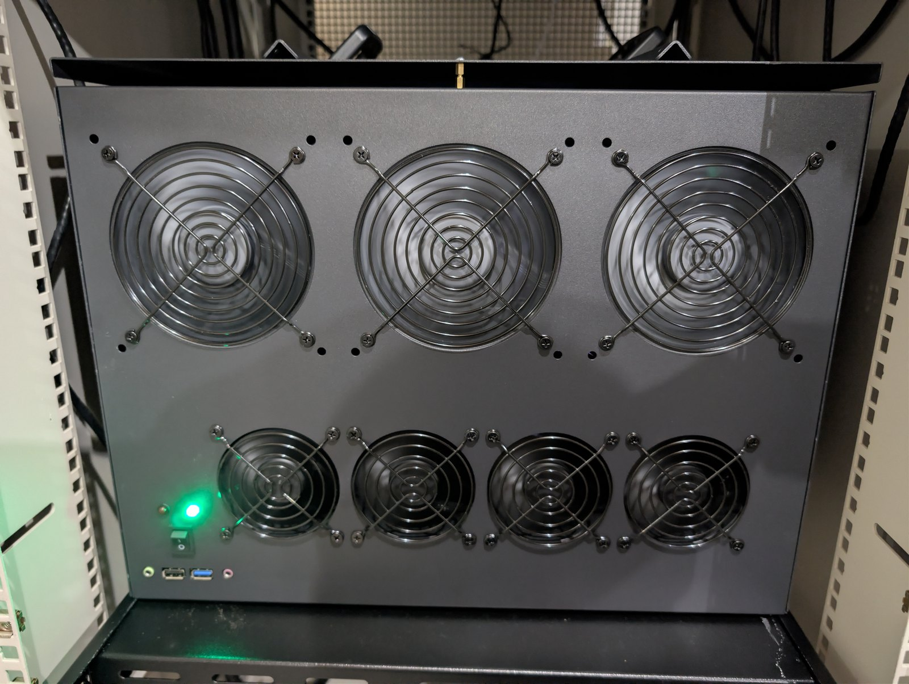
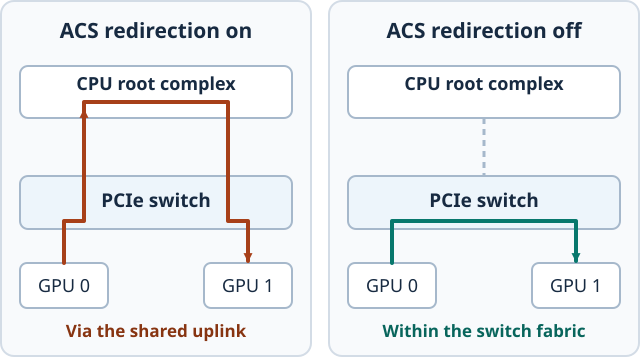

[The dream]() is alive! After four months of iterating on the design and waiting around for packages, I finally built a four-GPU AI server with a whopping 384 GB of VRAM. The model I built it for is the original DeepSeek-V4.1-Flash checkpoint. It has 552 billion backbone parameters and is one of the most capable open-weight models I wanted to run at home. With the Engram lookup table on NVMe, it processed uncached 32K-token prompts at about 15,350 input tokens per second. It generated 235 output tokens per second on a single request and 678 tokens per second in total across eight concurrent requests. [DeepSeek model card](https://huggingface.co/deepseek-ai/DeepSeek-V4.1-Flash)



## Why I used a PCIe switch

When a model spans four GPUs, the cards exchange partial results. Peer-to-peer access (P2P) lets one GPU read or write another GPU's memory directly. A PCIe switch can forward those transfers locally, leaving the CPU uplink available for host traffic.

My motherboard has two graphics slots, wired for Gen5 x8 each when both are occupied. The switch gives me four downstream Gen4 x16 links, with the MCIO cables on that downstream side. All four cards still share one Gen4 x16 uplink to the CPU, including when loading model weights from host memory.



_The drawing omits the extra PCIe bridges Linux sees inside the switch fabric. Diagram style inspired by [Doug's RTX 3090 splitter post](https://doug.sh/posts/pcie-splitter-rtx-3090/)._

## Building the hardware



I kept the Ryzen 9 7950X3D and ASUS ROG Crosshair X670E Hero. The Broadcom PEX88096 switch card occupies the top x16 slot; I leave the other CPU-connected graphics slot empty so the switch keeps all 16 lanes. The small blower cools the switch chip.



Each GPU gets a separate board with a PCIe x16 slot and a slot power input. The GPU also keeps its own power lead.



Two x8 MCIO cables carry each GPU's Gen4 x16 link to the switch. These separate adapters let me position the cards independently of the motherboard's slots.



I originally planned an external GPU box with a single switch backplane. Separate adapters let me fit everything in one custom [dual-chamber rackmount case](https://www.aliexpress.us/item/3256812027515666.html). Finding room for eight MCIO cables and the GPU power leads was still difficult.



I mounted the cards in pairs on either side of the motherboard area. The cables had to clear the CPU cooler, RAM, and front fans. The overhead view shows how little space remained.



The finished chassis went into the rack with a 240 V power supply. I'd already run a dedicated circuit when I [upgraded my house electrical system]().

## Getting all four GPUs to enumerate

My working settings were:

- Above 4G Decoding: on.
- Motherboard Resizable BAR toggle: off.
- GPU firmware profile: `physical_display_enabled_8GB_bar1` on all four cards, set with [NVIDIA Display Mode Selector 1.77](https://developer.nvidia.com/displaymodeselector).
- Linux boot parameter: `pci=realloc=on`.

The 8 GiB is BAR1, a PCIe address window into GPU memory. Each card still has 96 GB of VRAM. The larger compute-mode apertures and virtual-function reservations had caused resource allocation problems.

After reboot, `nvidia-smi -q` showed 8,192 MiB of BAR1 on every card. I checked the PCIe tree with `lspci -Dtv` and verified Gen4 x16 on the CPU uplink and GPU links under load.

## Getting peer traffic to stay on the switch

`nvidia-smi topo -p2p r` and `nvidia-smi topo -p2p w` reported access between every GPU pair. All 36 CUDA copy and peer-memory checks passed across the six pairs in both directions. With one pair active, copies reached 27.1–27.6 GB/s.

A four-GPU NCCL all-reduce reached only 5.53 GB/s. The switch ports showed `ReqRedir+ CmpltRedir+` under PCIe Access Control Services (ACS). Those settings can send peer requests and completions through the CPU root complex, even while transfers use peer memory. [NVIDIA's ACS troubleshooting guide](https://docs.nvidia.com/deeplearning/nccl/user-guide/docs/troubleshooting/gpu_troubleshooting.html#pci-access-control-services-acs)



I stopped inference, saved the original ACS settings, and cleared only the request and completion redirect bits on seven switch ports. Readback confirmed `ReqRedir- CmpltRedir-`. The CPU root port's settings stayed unchanged.

The same all-reduce then reached **21.50 GB/s**, up from **5.53 GB/s**. These are medians of three runs per setting, at 16 MiB per GPU with the model unloaded. NCCL reported `P2P/CUMEM` in both cases. The settings and speed change point to the detour in the diagram; I didn't trace individual packets.

With the same four-way vLLM configuration, GLM-5.3-Flash processed an uncached 32K-token prompt in **6.4 seconds**, down from **15.2 seconds** before the change.

## After a reboot

All seven switch ports returned to `ReqRedir+ CmpltRedir+` after reboot. The ACS change was applied at runtime; the BIOS settings and saved GPU profiles persist separately. The boot service below is a proposed way to reapply it. I tested the register writes by hand and haven't installed the service.

The opening DeepSeek scores came after I cleared redirection and before reboot. I didn't read the bits during that run or benchmark DeepSeek with both settings. The before-and-after comparisons used NCCL and GLM-5.3-Flash.

For DeepSeek-V4.1-Flash I used the Local Inference Lab serving profile with disk-backed Engram. I'll get into the model setup and the later vLLM tuning in another post. [The DeepSeek-V4.1-Flash serving guide I used](https://github.com/local-inference-lab/rtx6kpro/blob/master/models/deepseek-v4.1-flash.md)

<details markdown="1">
<summary>Optional: reapply the ACS change at Linux boot</summary>

A systemd oneshot service can run the same masked write after Linux enumerates the switch. I tested the register change by hand. The service below is how I'd make it persistent. I haven't installed it on this machine. Linux also documents `pci=config_acs`, but upstream 6.11 can fall back to the firmware value for bits marked `0`. The script below reads the hardware back to confirm the two bits actually cleared. [Linux 6.11 PCI implementation](https://github.com/torvalds/linux/blob/v6.11/drivers/pci/pci.c#L957-L1035)

First, use `lspci -Dtv` and `lspci -DPP -d 1000:c010` to identify the switch ports in the paths to the GPUs. The addresses below are from my machine. Replace them with the verified ports on your system. Clearing these ACS bits affects PCIe peer isolation, so scope the change to the GPU switch ports you intend to share.

Save this as `/usr/local/sbin/gpu-switch-acs`. It checks that all seven devices are Broadcom switch bridges below my GPU root port and have readable ACS controls before it writes anything. The `000c` mask selects only request and completion redirection.

```bash
#!/bin/bash
set -euo pipefail

root=$(readlink -e /sys/bus/pci/devices/0000:00:01.1)
ports=(
    0000:02:00.0 0000:02:04.0 0000:02:08.0 0000:04:10.0
    0000:07:00.0 0000:07:10.0 0000:0b:00.0
)

for port in "${ports[@]}"; do
    device=$(readlink -e "/sys/bus/pci/devices/$port")
    if [[ $device != "$root/"* || $(cat "$device/vendor") != 0x1000 ||
          $(cat "$device/device") != 0xc010 || $(cat "$device/class") != 0x060400 ]]; then
        echo "Unexpected PCIe topology or device at $port" >&2
        exit 1
    fi
    value=$(setpci -s "$port" ECAP_ACS+6.w)
    [[ $value =~ ^[0-9a-fA-F]{4}$ && ${value,,} != ffff ]] || exit 1
done

for port in "${ports[@]}"; do
    setpci -s "$port" ECAP_ACS+6.w=0000:000c
    value=$(setpci -s "$port" ECAP_ACS+6.w)
    if [[ ! $value =~ ^[0-9a-fA-F]{4}$ ]] || (( (16#$value & 0x000c) != 0 )); then
        echo "ACS redirection is still enabled or unreadable at $port" >&2
        exit 1
    fi
done
```

Save the unit as `/etc/systemd/system/gpu-switch-acs.service`.

```ini
[Unit]
Description=Clear peer redirection on GPU PCIe switch ports

[Service]
Type=oneshot
ExecStart=/bin/bash /usr/local/sbin/gpu-switch-acs
RemainAfterExit=yes

[Install]
WantedBy=multi-user.target
```

Run `sudo systemctl daemon-reload` and `sudo systemctl enable gpu-switch-acs.service` to schedule it for the next boot. If inference also starts from a systemd unit, give that unit both `Requires=gpu-switch-acs.service` and `After=gpu-switch-acs.service` so inference waits for the check to succeed.

After reboot, check `systemctl status gpu-switch-acs.service` and confirm that `sudo lspci -Dvv -s <port>` reports `ReqRedir- CmpltRedir-` under `ACSCtl` on each targeted port. Then repeat the four-GPU all-reduce to check performance. To go back to the defaults, disable the service and reboot.

</details>
